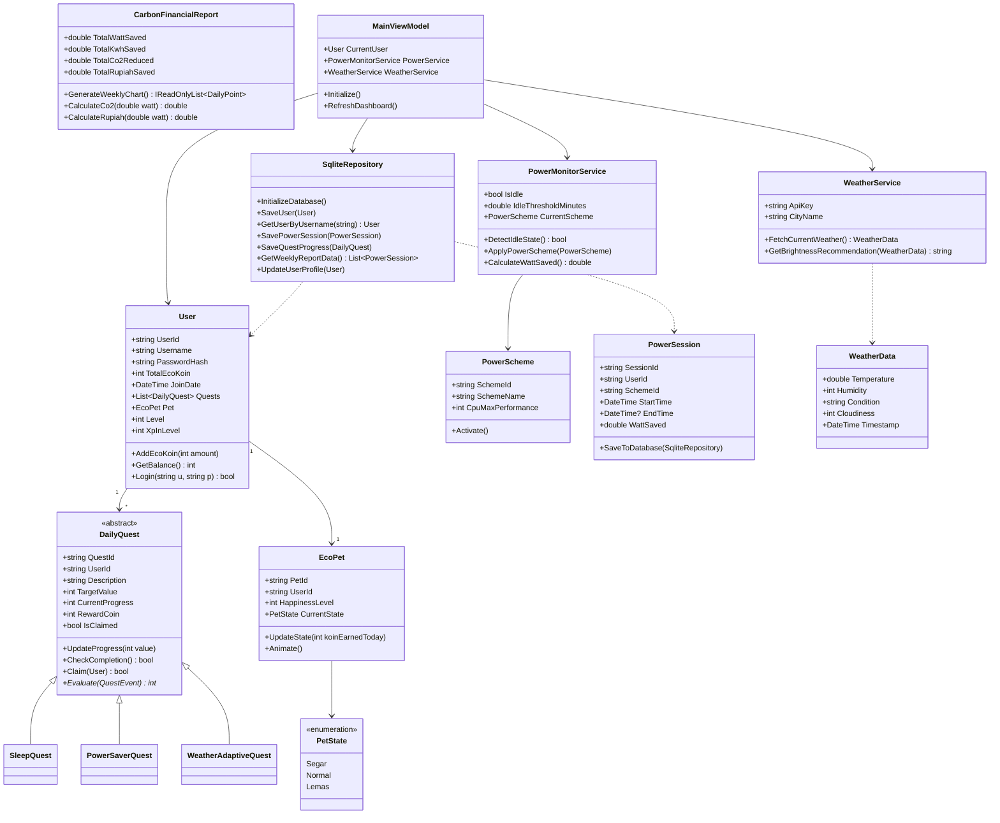

# 3. Model Domain

> Spesifikasi **kondisi target**. Namespace: `EcoKoin.Models`, `EcoKoin.Services`, `EcoKoin.ViewModels` (proyek `EcoKoin.Core`). Status implementasi saat ini: [dokumen 8](08-status-roadmap.md).

## Class diagram



Class diagram versi asli (rancangan awal): [README](../README.md).

## Konsep PBO yang dipakai

| Konsep | Penerapan |
|---|---|
| Abstraction | `DailyQuest` abstrak dengan `Evaluate(QuestEvent)` |
| Inheritance | `SleepQuest`, `PowerSaverQuest`, `WeatherAdaptiveQuest` mewarisi `DailyQuest` |
| Polymorphism | ViewModel memanggil `quest.Evaluate(evt)` tanpa peduli jenis quest |
| Encapsulation | Setter `CurrentProgress`/`IsClaimed` hanya diubah lewat `UpdateProgress`/`Claim` |

## Models

### `User`
| Member | Perilaku |
|---|---|
| `UserId`, `Username`, `PasswordHash`, `JoinDate` | identitas; `Username` unik |
| `TotalEcoKoin` | saldo; hanya berubah lewat `AddEcoKoin` |
| `Quests` | quest hari ini (1—*) |
| `Pet` | EcoPet (1—1) |
| `AddEcoKoin(int amount)` | menambah saldo; `amount <= 0` → `ArgumentOutOfRangeException` |
| `GetBalance()` | mengembalikan `TotalEcoKoin` |
| `Login(string u, string p)` | `true` bila `u` cocok dengan `Username` dan hash PBKDF2 `p` cocok dengan `PasswordHash`; tanpa menyimpan password asli |
| `Level`, `XpInLevel` | turunan: `Level = TotalEcoKoin / 500 + 1`, `XpInLevel = TotalEcoKoin % 500` (tampil "350 / 500 XP") |

### `DailyQuest` (abstrak) dan turunan
| Member | Perilaku |
|---|---|
| `TargetValue`, `CurrentProgress`, `RewardCoin`, `IsClaimed` | data quest |
| `UpdateProgress(int value)` | menambah progres, dibatasi maksimum `TargetValue` |
| `CheckCompletion()` | `CurrentProgress >= TargetValue` |
| `Claim(User)` | bila selesai dan belum diklaim: `user.AddEcoKoin(RewardCoin)`, `IsClaimed = true`, return `true`; selain itu `false` (idempoten, tidak bisa klaim dua kali) |
| `Evaluate(QuestEvent)` | abstrak; mengembalikan penambahan progres untuk event tertentu |

| Turunan | Event yang dihitung | Target/Reward contoh |
|---|---|---|
| `SleepQuest` | PC masuk sleep/idle-lock saat ditinggal | 1 kali → +30 |
| `PowerSaverQuest` | menit skema hemat daya aktif | 240 menit (4 jam) → +20 |
| `WeatherAdaptiveQuest` | rekomendasi cuaca diterapkan | 1 kali → +15 |

Jenis quest dipersist di kolom `quest_type` ([dokumen 4](04-database.md)).

### `EcoPet` & `PetState`
`PetState`: `Segar`, `Normal`, `Lemas`.

| Member | Perilaku |
|---|---|
| `UpdateState(int koinEarnedToday)` | `>= 30` → `Segar`; `10–29` → `Normal`; `< 10` → `Lemas`; `HappinessLevel` (0–100) disesuaikan dan di-*clamp* |
| `Animate()` | memicu pergantian gambar/animasi: Segar → `happy.png`, Normal → `netral.png`, Lemas → `sad.png` |

### `PowerScheme`
Profil daya: `SchemeName`, `CpuMaxPerformance` (persen). `Activate()` menerapkan lewat `powercfg` (set `PROCTHROTTLEMAX` ke `CpuMaxPerformance` lalu `/setactive`); melempar `InvalidOperationException` bila perintah gagal. Data awal: *Power Saver* (50), *Balanced* (80).

### `PowerSession`
Satu sesi pemakaian skema. `EndTime` nullable (`null` = sesi berjalan). `WattSaved` terisi saat sesi ditutup. `SaveToDatabase(repo)` mendelegasikan ke `SqliteRepository.SavePowerSession`.

### `WeatherData`
DTO sementara (tidak disimpan): `Temperature` (°C), `Humidity` (%), `Condition`, `Cloudiness` (%), `Timestamp`.

### `CarbonFinancialReport`
Dihitung dari daftar `PowerSession`. Rumus (nilai default dapat diatur di `appsettings.json`):

```
kWhHemat   = Σ (watt_saved × durasi_jam) / 1000
CO₂ (kg)   = kWhHemat × 0.87        (faktor emisi listrik, kg CO₂/kWh)
Rupiah     = kWhHemat × 1444.70     (tarif listrik, Rp/kWh)
```

| Member | Perilaku |
|---|---|
| `CalculateCo2(double watt)` | CO₂ (kg) untuk energi `watt` Wh; input negatif → 0 |
| `CalculateRupiah(double watt)` | biaya (Rp) untuk energi `watt` Wh |
| `GenerateWeeklyChart()` | tepat 7 titik `DailyPoint { Date, KwhSaved }` (hari terlama → terbaru; hari tanpa sesi = 0) |

## Services

### `PowerMonitorService`
| Member | Perilaku |
|---|---|
| `IdleThresholdMinutes` | default 5 |
| `DetectIdleState()` | Win32 `GetLastInputInfo`; `IsIdle = idleDuration >= IdleThresholdMinutes` |
| `ApplyPowerScheme(PowerScheme)` | `scheme.Activate()` lalu set `CurrentScheme` |
| `CalculateWattSaved()` | estimasi: `BaselineWatt × (100 − CpuMaxPerformance) / 100`; bila sesi berlangsung saat idle/sleep ditambah penghematan sleep (baseline × 0,9). Hasil adalah **estimasi** |

### `WeatherService`
| Member | Perilaku |
|---|---|
| `FetchCurrentWeather()` | `GET https://api.openweathermap.org/data/2.5/weather?q={CityName}&units=metric&appid={ApiKey}`; memetakan `main.temp`, `main.humidity`, `weather[0].main`, `clouds.all`; cache `CacheMinutes`; saat gagal mengembalikan cache terakhir bila ada, selain itu melempar `WeatherUnavailableException` |
| `GetBrightnessRecommendation(WeatherData)` | `Cloudiness >= 60` → "Turunkan kecerahan ke 40%"; `30–59` → "Turunkan kecerahan ke 60%"; `< 30` → "Kecerahan sudah optimal" |

### `SqliteRepository`
Konstruktor menerima connection string (default dari `Database:Path`). Tiap koneksi menjalankan `PRAGMA foreign_keys = ON`. Semua query diparameterisasi.

| Method | Perilaku |
|---|---|
| `InitializeDatabase()` | membuat folder/file DB bila belum ada, menjalankan `schema.sql` (idempoten) |
| `SaveUser` / `UpdateUserProfile` | upsert `USERS` (+ `ECO_PETS`) dalam satu transaksi |
| `GetUserByUsername(string)` | memuat `User` lengkap dengan `Pet` dan `Quests`; `null` bila tidak ada |
| `SavePowerSession(PowerSession)` | insert/update sesi |
| `SaveQuestProgress(DailyQuest)` | update `current_progress`, `is_claimed` |
| `GetWeeklyReportData()` | sesi 7 hari terakhir milik pengguna aktif, terurut `start_time` |

## ViewModel

### `MainViewModel` (`INotifyPropertyChanged`)
| Member | Perilaku |
|---|---|
| `CurrentUser`, `PowerService`, `WeatherService` | dependensi/state, dinotifikasi ke View |
| `Initialize()` | memuat user, quest, pet, skema; menyalakan timer |
| `RefreshDashboard()` | memperbarui cuaca, status daya, kartu statistik, laporan mingguan, daftar quest |
| Command | `ApplyRecommendationCommand`, `ClaimQuestCommand(quest)`, `RefreshCommand`, `NavigateCommand(page)` |
