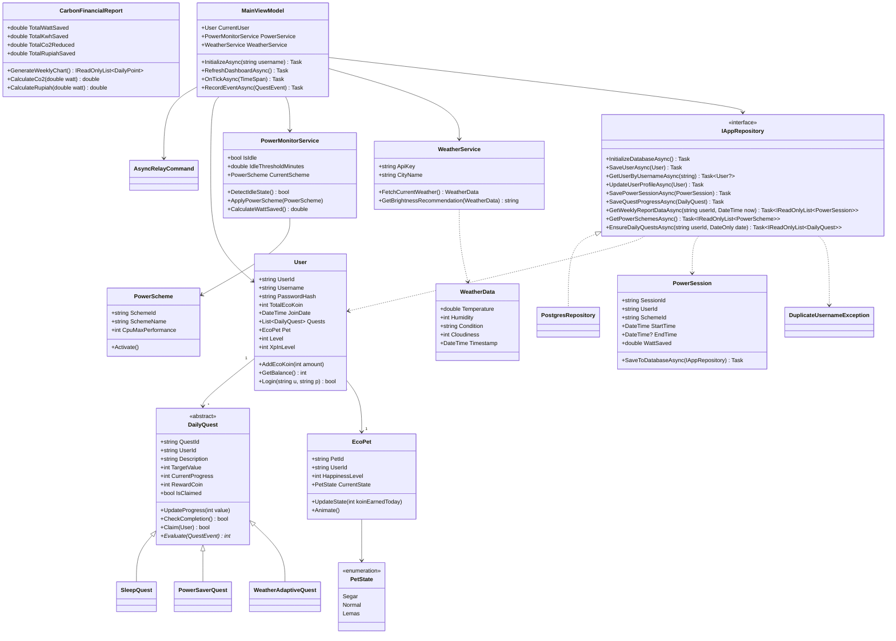

# 3. Model Domain

> Spesifikasi **kondisi target**. Namespace: `EcoKoin.Models`, `EcoKoin.Services`, `EcoKoin.ViewModels` (proyek `EcoKoin.Core`). Status implementasi saat ini: [dokumen 8](08-status-roadmap.md).

## Class diagram



Class diagram versi asli (rancangan awal): [README](../README.md).

## Konsep PBO yang dipakai

| Konsep | Penerapan |
|---|---|
| Abstraction | `DailyQuest` abstrak dengan `Evaluate(QuestEvent)` |
| Inheritance | `SleepQuest`, `PowerSaverQuest`, `WeatherAdaptiveQuest` mewarisi `DailyQuest` |
| Polymorphism | ViewModel memanggil `quest.Evaluate(evt)` tanpa peduli jenis quest |
| Encapsulation | Setter `CurrentProgress`/`IsClaimed` hanya diubah lewat `UpdateProgress`/`Claim` |

## Models

### `User`
| Member | Perilaku |
|---|---|
| `UserId`, `Username`, `PasswordHash`, `JoinDate` | identitas; `Username` unik |
| `TotalEcoKoin` | saldo; hanya berubah lewat `AddEcoKoin` |
| `Quests` | quest hari ini (1—*) |
| `Pet` | EcoPet (1—1) |
| `AddEcoKoin(int amount)` | menambah saldo; `amount <= 0` → `ArgumentOutOfRangeException` |
| `GetBalance()` | mengembalikan `TotalEcoKoin` |
| `Login(string u, string p)` | `true` bila `u` cocok dengan `Username` dan hash PBKDF2 `p` cocok dengan `PasswordHash`; tanpa menyimpan password asli |
| `Level`, `XpInLevel` | turunan: `Level = TotalEcoKoin / 500 + 1`, `XpInLevel = TotalEcoKoin % 500` (tampil "350 / 500 XP") |

### `DailyQuest` (abstrak) dan turunan
| Member | Perilaku |
|---|---|
| `TargetValue`, `CurrentProgress`, `RewardCoin`, `IsClaimed` | data quest |
| `UpdateProgress(int value)` | menambah progres, dibatasi maksimum `TargetValue` |
| `CheckCompletion()` | `CurrentProgress >= TargetValue` |
| `Claim(User)` | bila selesai dan belum diklaim: `user.AddEcoKoin(RewardCoin)`, `IsClaimed = true`, return `true`; selain itu `false` (idempoten, tidak bisa klaim dua kali) |
| `Evaluate(QuestEvent)` | abstrak; mengembalikan penambahan progres untuk event tertentu |

| Turunan | Event yang dihitung | Target/Reward contoh |
|---|---|---|
| `SleepQuest` | PC masuk sleep/idle-lock saat ditinggal | 1 kali → +30 |
| `PowerSaverQuest` | menit skema hemat daya aktif | 240 menit (4 jam) → +20 |
| `WeatherAdaptiveQuest` | rekomendasi cuaca diterapkan | 1 kali → +15 |

Jenis quest dipersist di kolom `quest_type` ([dokumen 4](04-database.md)).

### `EcoPet` & `PetState`
`PetState`: `Segar`, `Normal`, `Lemas`.

| Member | Perilaku |
|---|---|
| `UpdateState(int koinEarnedToday)` | `>= 30` → `Segar`; `10–29` → `Normal`; `< 10` → `Lemas`; `HappinessLevel` (0–100) disesuaikan dan di-*clamp* |
| `Animate()` | memicu pergantian gambar/animasi: Segar → `happy.png`, Normal → `netral.png`, Lemas → `sad.png` |

### `PowerScheme`
Profil daya: `SchemeName`, `CpuMaxPerformance` (persen). `Activate()` menerapkan lewat `powercfg` (set `PROCTHROTTLEMAX` ke `CpuMaxPerformance` lalu `/setactive`); melempar `InvalidOperationException` bila perintah gagal. Data awal: *Power Saver* (50), *Balanced* (80).

### `PowerSession`
Satu sesi pemakaian skema. `EndTime` nullable (`null` = sesi berjalan). `WattSaved` terisi saat sesi ditutup. `SaveToDatabaseAsync(repo)` mendelegasikan ke `IAppRepository.SavePowerSessionAsync`.

### `WeatherData`
DTO sementara (tidak disimpan): `Temperature` (°C), `Humidity` (%), `Condition`, `Cloudiness` (%), `Timestamp`.

### `CarbonFinancialReport`
Dihitung dari daftar `PowerSession`. Rumus (nilai default dapat diatur di `appsettings.json`):

```
kWhHemat   = Σ (watt_saved × durasi_jam) / 1000
CO₂ (kg)   = kWhHemat × 0.87        (faktor emisi listrik, kg CO₂/kWh)
Rupiah     = kWhHemat × 1444.70     (tarif listrik, Rp/kWh)
```

| Member | Perilaku |
|---|---|
| `CalculateCo2(double watt)` | CO₂ (kg) untuk energi `watt` Wh; input negatif → 0 |
| `CalculateRupiah(double watt)` | biaya (Rp) untuk energi `watt` Wh |
| `GenerateWeeklyChart()` | tepat 7 titik `DailyPoint { Date, KwhSaved }` (hari terlama → terbaru; hari tanpa sesi = 0) |

## Services

### `PowerMonitorService`
| Member | Perilaku |
|---|---|
| `IdleThresholdMinutes` | default 5 |
| `DetectIdleState()` | Win32 `GetLastInputInfo`; `IsIdle = idleDuration >= IdleThresholdMinutes` |
| `ApplyPowerScheme(PowerScheme)` | `scheme.Activate()` lalu set `CurrentScheme` |
| `CalculateWattSaved()` | estimasi: `BaselineWatt × (100 − CpuMaxPerformance) / 100`; bila sesi berlangsung saat idle/sleep ditambah penghematan sleep (baseline × 0,9). Hasil adalah **estimasi** |

### `WeatherService`
| Member | Perilaku |
|---|---|
| `FetchCurrentWeather()` | `GET https://api.openweathermap.org/data/2.5/weather?q={CityName}&units=metric&appid={ApiKey}`; memetakan `main.temp`, `main.humidity`, `weather[0].main`, `clouds.all`; cache `CacheMinutes`; saat gagal mengembalikan cache terakhir bila ada, selain itu melempar `WeatherUnavailableException` |
| `GetBrightnessRecommendation(WeatherData)` | `Cloudiness >= 60` → "Turunkan kecerahan ke 40%"; `30–59` → "Turunkan kecerahan ke 60%"; `< 30` → "Kecerahan sudah optimal" |

### `IAppRepository` dan `PostgresRepository`
`IAppRepository` adalah antarmuka akses data **async** (semua method mengembalikan `Task` dan menerima `CancellationToken`). Implementasi produksi: `PostgresRepository` (Npgsql, server PostgreSQL remote). `DatabaseConfig.CreateFromEnvironment()` membuatnya dari environment variable `ECOKOIN_DB_CONNECTION`; bila variabel kosong, melempar `InvalidOperationException` dengan petunjuk (tanpa menampilkan connection string). Semua query diparameterisasi dan penulisan multi-tabel memakai transaksi.

SQLite **bukan** bagian produk: `SqliteTestRepository` hanya ada di proyek tes (`tests/EcoKoin.Core.Tests/Support`) sebagai implementasi tes yang cepat dan offline. Kedua implementasi harus lulus suite kontrak yang sama (`RepositoryContractTests`).

| Method | Perilaku |
|---|---|
| `InitializeDatabaseAsync()` | menjalankan skema PostgreSQL + data awal (idempoten) |
| `SaveUserAsync(User)` | upsert `USERS` (+ `ECO_PETS`, quest) dalam satu transaksi; nama pengguna sudah dipakai pengguna lain → `DuplicateUsernameException`; `DisplayName` tersimpan tidak ditimpa `null` |
| `GetUserByUsernameAsync(string)` | memuat `User` lengkap dengan `Pet` dan quest tanggal terbaru; `null` bila tidak ada |
| `UpdateUserProfileAsync(User)` | memperbarui koin, pet, dan quest dalam satu transaksi; user tidak ada → `InvalidOperationException` |
| `SavePowerSessionAsync(PowerSession)` | insert/update sesi (`EndTime == null` ↔ `NULL`) |
| `SaveQuestProgressAsync(DailyQuest)` | upsert baris quest (`current_progress`, `is_claimed`) |
| `GetWeeklyReportDataAsync(userId, now)` | sesi 7 hari terakhir milik pengguna, terurut `start_time` |
| `GetPowerSchemesAsync()` | semua skema daya, terurut `cpu_max_performance` |
| `EnsureDailyQuestsAsync(userId, date)` | membuat 3 quest default bila belum ada pada tanggal itu, lalu mengembalikan quest tanggal tersebut |

### `DuplicateUsernameException`
Pengecualian netral-penyedia untuk nama pengguna (email) yang sudah terdaftar. Layer UI menangkapnya (`AccountService.RegisterAsync` mengembalikan `false`) tanpa tergantung pada kode kesalahan PostgreSQL atau SQLite.

## ViewModel

### `MainViewModel` (`INotifyPropertyChanged`)
Konstruktor: `MainViewModel(IAppRepository repo, PowerMonitorService power, WeatherService weather, IClock clock)`. Semua operasi yang menyentuh database bersifat async agar UI tidak membeku saat menunggu jaringan.

| Member | Perilaku |
|---|---|
| `CurrentUser`, `PowerService`, `WeatherService`, `Quests`, `WeeklyReport`, `CurrentWeather`, `WeatherStale`, dll. | state, dinotifikasi ke View lewat `INotifyPropertyChanged` |
| `InitializeAsync(username)` | menyiapkan skema (`InitializeDatabaseAsync`), memuat user, quest hari ini, pet, skema daya, lalu `RefreshDashboardAsync()` |
| `RefreshDashboardAsync()` | memperbarui cuaca, status daya, kartu statistik, laporan mingguan, daftar quest |
| `OnTickAsync(TimeSpan)` | dipanggil timer di UI: menambah menit PowerSaver dan menyegarkan cuaca |
| `RecordEventAsync(QuestEvent)` | meneruskan event (mis. `SleepEntered`) ke quest dan menyimpan progres |
| `ApplyRecommendationCommand`, `ClaimQuestCommand(quest)`, `RefreshCommand` | `AsyncRelayCommand`; kegagalan memunculkan `LastError` dan event `CommandFailed` (tidak ditelan diam-diam) |

### `AsyncRelayCommand`
`ICommand` untuk aksi async: tidak dapat dijalankan ulang selama masih berjalan (`IsRunning`), `ExecuteAsync` dapat di-`await`, dan galat diteruskan ke callback `onError`.
