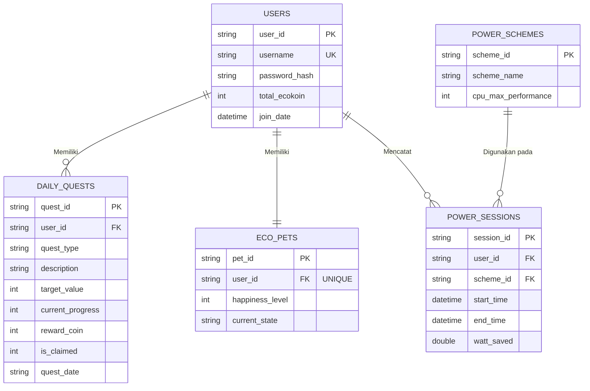

# 4. Basis Data

> Spesifikasi **kondisi target** (skema v2). Baseline v1 (sesuai ERD tugas Modul 4) ada di [`Database/schema.sql`](../Database/schema.sql), [ERD.md](ERD.md), [DATABASE_PROOF.md](DATABASE_PROOF.md); perubahan v1 → v2 dirinci di bawah.

Basis data: **SQLite**, satu file lokal per pengguna (`%LOCALAPPDATA%\EcoKoin\ecokoin.db`).

## Diagram relasi



## Tabel (v2)

### `USERS`
| Kolom | Tipe | Constraint |
|---|---|---|
| `user_id` | TEXT | PK |
| `username` | TEXT | NOT NULL, UNIQUE |
| `password_hash` | TEXT | NOT NULL (PBKDF2, format `iter.salt.hash`) |
| `total_ecokoin` | INTEGER | NOT NULL, default 0, `CHECK (>= 0)` |
| `join_date` | TEXT | NOT NULL (`YYYY-MM-DD HH:MM:SS`) |

### `DAILY_QUESTS`
| Kolom | Tipe | Constraint |
|---|---|---|
| `quest_id` | TEXT | PK |
| `user_id` | TEXT | NOT NULL, FK → `USERS` |
| `quest_type` | TEXT | NOT NULL, `CHECK IN ('Sleep','PowerSaver','WeatherAdaptive')` |
| `description` | TEXT | NOT NULL |
| `target_value` | INTEGER | NOT NULL, `> 0` |
| `current_progress` | INTEGER | NOT NULL, default 0 |
| `reward_coin` | INTEGER | NOT NULL, `> 0` |
| `is_claimed` | INTEGER | NOT NULL, default 0 (0/1) |
| `quest_date` | TEXT | NOT NULL (`YYYY-MM-DD`); quest direset tiap hari |

### `ECO_PETS`
| Kolom | Tipe | Constraint |
|---|---|---|
| `pet_id` | TEXT | PK |
| `user_id` | TEXT | NOT NULL, **UNIQUE**, FK → `USERS` (1—1) |
| `happiness_level` | INTEGER | NOT NULL, default 0, `0–100` |
| `current_state` | TEXT | NOT NULL, `CHECK IN ('Segar','Normal','Lemas')` |

### `POWER_SCHEMES`
| Kolom | Tipe | Constraint |
|---|---|---|
| `scheme_id` | TEXT | PK |
| `scheme_name` | TEXT | NOT NULL |
| `cpu_max_performance` | INTEGER | NOT NULL, `0–100` |

### `POWER_SESSIONS`
| Kolom | Tipe | Constraint |
|---|---|---|
| `session_id` | TEXT | PK |
| `user_id` | TEXT | NOT NULL, FK → `USERS` |
| `scheme_id` | TEXT | NOT NULL, FK → `POWER_SCHEMES` |
| `start_time` | TEXT | NOT NULL |
| `end_time` | TEXT | NULL = sesi berjalan |
| `watt_saved` | REAL | NOT NULL, default 0 |

Indeks: `CREATE INDEX idx_sessions_user_start ON POWER_SESSIONS(user_id, start_time);` dan `idx_quests_user_date ON DAILY_QUESTS(user_id, quest_date);`.

## Perubahan v1 → v2

| Perubahan | Alasan |
|---|---|
| `USERS.password_hash` | mendukung `User.Login` |
| `DAILY_QUESTS.quest_type` | diskriminator subclass `SleepQuest` / `PowerSaverQuest` / `WeatherAdaptiveQuest` |
| `DAILY_QUESTS.reward_coin`, `is_claimed`, `quest_date` | reward tombol *Klaim +N*, status klaim, reset harian |
| `CHECK` constraint pada status/rentang | integritas di level DB |
| Dua indeks | query laporan mingguan dan quest harian |

Relasi dan entitas tidak berubah: 5 tabel, 4 relasi sama dengan [ERD.md](ERD.md). `WeatherData` dan `CarbonFinancialReport` tetap **bukan tabel**.

## Pemetaan class ↔ tabel

| Class | Tabel |
|---|---|
| `User` | `USERS` |
| `DailyQuest` + 3 turunan | `DAILY_QUESTS` (`quest_type` memilih class) |
| `EcoPet` / `PetState` | `ECO_PETS` (`current_state` TEXT ↔ enum) |
| `PowerScheme` | `POWER_SCHEMES` |
| `PowerSession` | `POWER_SESSIONS` (`EndTime` nullable ↔ `end_time` NULL) |
| `WeatherData`, `CarbonFinancialReport` | — |

## Inisialisasi & data awal

- `SqliteRepository.InitializeDatabase()` menjalankan `schema.sql` (semua `CREATE ... IF NOT EXISTS`, aman diulang).
- `Database/seed.sql` mengisi `POWER_SCHEMES` (Power Saver 50, Balanced 80) dan akun demo; dijalankan hanya bila tabel kosong.
- Quest harian dibuat otomatis (3 quest, `quest_date = hari ini`) saat startup bila belum ada.

Membuat ulang manual:

```bash
rm -f Database/ecokoin.db
sqlite3 Database/ecokoin.db < Database/schema.sql
sqlite3 Database/ecokoin.db < Database/seed.sql
```

## Query utama

Laporan mingguan (7 hari, per hari):

```sql
SELECT date(start_time) AS hari,
       SUM(watt_saved * (julianday(end_time) - julianday(start_time)) * 24) / 1000.0 AS kwh_saved
FROM POWER_SESSIONS
WHERE user_id = :user_id
  AND end_time IS NOT NULL
  AND start_time >= datetime('now', '-7 days')
GROUP BY date(start_time)
ORDER BY hari;
```

Quest hari ini:

```sql
SELECT * FROM DAILY_QUESTS WHERE user_id = :user_id AND quest_date = date('now');
```

Klaim reward (satu transaksi):

```sql
BEGIN;
UPDATE DAILY_QUESTS SET is_claimed = 1
 WHERE quest_id = :id AND is_claimed = 0 AND current_progress >= target_value;
UPDATE USERS SET total_ecokoin = total_ecokoin + :reward WHERE user_id = :user_id;
COMMIT;
```

## Aturan operasional

- `PRAGMA foreign_keys = ON;` dijalankan pada **setiap** koneksi.
- Semua query diparameterisasi; tidak ada konkatenasi string SQL.
- Penulisan multi-tabel memakai transaksi.
- Password tidak pernah disimpan polos; hanya `password_hash`.
