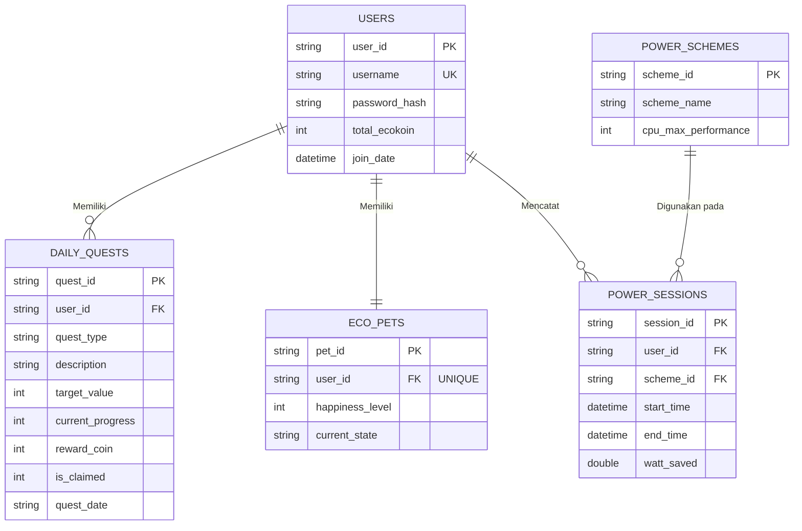

# 4. Basis Data

> Spesifikasi **kondisi target** (skema v2). Baseline v1 (sesuai ERD tugas Modul 4) ada di [ERD.md](ERD.md) dan [DATABASE_PROOF.md](DATABASE_PROOF.md); perubahan v1 → v2 dirinci di bawah. Skema yang dijalankan aplikasi: [`src/EcoKoin.Core/Database/schema.sql`](../src/EcoKoin.Core/Database/schema.sql) (+ `seed.sql`), keduanya *embedded resource* di `EcoKoin.Core`.

Basis data: **PostgreSQL remote** (server di luar PC pengguna), diakses lewat `Npgsql` dan `IAppRepository`. Persyaratan tugas **tidak mengizinkan database lokal**, sehingga aplikasi tidak membuat atau memakai file database di PC pengguna. Connection string dibaca dari environment variable `ECOKOIN_DB_CONNECTION` dan tidak pernah disimpan di repo ([dokumen 7](07-setup.md)). SQLite hanya dipakai di proyek tes (`SqliteTestRepository`).

## Diagram relasi



## Tabel (v2)

### `USERS`
| Kolom | Tipe | Constraint |
|---|---|---|
| `user_id` | TEXT | PK |
| `username` | TEXT | NOT NULL, UNIQUE (`uq_users_username`); berisi email yang dinormalisasi (huruf kecil) |
| `display_name` | TEXT | nama tampilan (boleh NULL) |
| `password_hash` | TEXT | NOT NULL (PBKDF2, format `iter.salt.hash`) |
| `total_ecokoin` | INTEGER | NOT NULL, default 0, `CHECK (>= 0)` |
| `join_date` | TIMESTAMP | NOT NULL |

### `DAILY_QUESTS`
| Kolom | Tipe | Constraint |
|---|---|---|
| `quest_id` | TEXT | PK |
| `user_id` | TEXT | NOT NULL, FK → `USERS` |
| `quest_type` | TEXT | NOT NULL, `CHECK IN ('Sleep','PowerSaver','WeatherAdaptive')` |
| `description` | TEXT | NOT NULL |
| `target_value` | INTEGER | NOT NULL, `> 0` |
| `current_progress` | INTEGER | NOT NULL, default 0 |
| `reward_coin` | INTEGER | NOT NULL, `> 0` |
| `is_claimed` | BOOLEAN | NOT NULL, default `FALSE` |
| `quest_date` | DATE | NOT NULL; quest direset tiap hari |
| `seq` | BIGINT | `GENERATED ALWAYS AS IDENTITY`; menjaga urutan penyisipan quest |

### `ECO_PETS`
| Kolom | Tipe | Constraint |
|---|---|---|
| `pet_id` | TEXT | PK |
| `user_id` | TEXT | NOT NULL, **UNIQUE**, FK → `USERS` (1—1) |
| `happiness_level` | INTEGER | NOT NULL, default 0, `0–100` |
| `current_state` | TEXT | NOT NULL, `CHECK IN ('Segar','Normal','Lemas')` |

### `POWER_SCHEMES`
| Kolom | Tipe | Constraint |
|---|---|---|
| `scheme_id` | TEXT | PK |
| `scheme_name` | TEXT | NOT NULL |
| `cpu_max_performance` | INTEGER | NOT NULL, `0–100` |

### `POWER_SESSIONS`
| Kolom | Tipe | Constraint |
|---|---|---|
| `session_id` | TEXT | PK |
| `user_id` | TEXT | NOT NULL, FK → `USERS` |
| `scheme_id` | TEXT | NOT NULL, FK → `POWER_SCHEMES` |
| `start_time` | TIMESTAMP | NOT NULL |
| `end_time` | TIMESTAMP | NULL = sesi berjalan |
| `watt_saved` | DOUBLE PRECISION | NOT NULL, default 0 |

Indeks: `CREATE INDEX idx_sessions_user_start ON POWER_SESSIONS(user_id, start_time);` dan `idx_quests_user_date ON DAILY_QUESTS(user_id, quest_date);`.

## Perubahan v1 → v2

| Perubahan | Alasan |
|---|---|
| `USERS.password_hash` | mendukung `User.Login` |
| `DAILY_QUESTS.quest_type` | diskriminator subclass `SleepQuest` / `PowerSaverQuest` / `WeatherAdaptiveQuest` |
| `DAILY_QUESTS.reward_coin`, `is_claimed`, `quest_date` | reward tombol *Klaim +N*, status klaim, reset harian |
| `CHECK` constraint pada status/rentang | integritas di level DB |
| `USERS.display_name` | nama tampilan akun di UI |
| Dialek PostgreSQL | tipe `TIMESTAMP`/`DATE`/`BOOLEAN`/`DOUBLE PRECISION`, `GENERATED ... AS IDENTITY` |
| Dua indeks | query laporan mingguan dan quest harian |

Relasi dan entitas tidak berubah: 5 tabel, 4 relasi sama dengan [ERD.md](ERD.md). `WeatherData` dan `CarbonFinancialReport` tetap **bukan tabel**.

## Pemetaan class ↔ tabel

| Class | Tabel |
|---|---|
| `User` | `USERS` |
| `DailyQuest` + 3 turunan | `DAILY_QUESTS` (`quest_type` memilih class) |
| `EcoPet` / `PetState` | `ECO_PETS` (`current_state` TEXT ↔ enum) |
| `PowerScheme` | `POWER_SCHEMES` |
| `PowerSession` | `POWER_SESSIONS` (`EndTime` nullable ↔ `end_time` NULL) |
| `WeatherData`, `CarbonFinancialReport` | — |

## Inisialisasi & data awal

- `IAppRepository.InitializeDatabaseAsync()` (`PostgresRepository`) menjalankan `schema.sql` lalu `seed.sql` dalam satu transaksi. Semua `CREATE ... IF NOT EXISTS` dan `INSERT ... ON CONFLICT DO NOTHING`, jadi aman diulang. Pengguna database harus punya hak `CREATE` pada schema-nya (biasanya `public`) saat pertama kali dijalankan.
- `seed.sql` hanya mengisi `POWER_SCHEMES` (Power Saver 50, Balanced 80). Tidak ada akun demo; akun dibuat lewat halaman registrasi.
- Quest harian dibuat otomatis (3 quest, `quest_date = hari ini`) lewat `EnsureDailyQuestsAsync` bila belum ada.

Membuat ulang / memeriksa manual dengan `psql` (ganti placeholder; jangan menulis password di riwayat shell, gunakan `PGPASSWORD` atau `~/.pgpass`):

```bash
psql "host=<host> port=5432 dbname=<db> user=<user> sslmode=require" \
     -f src/EcoKoin.Core/Database/schema.sql \
     -f src/EcoKoin.Core/Database/seed.sql
psql "host=<host> dbname=<db> user=<user> sslmode=require" -c "\dt"
```

Hasil `\dt`: `daily_quests`, `eco_pets`, `power_schemes`, `power_sessions`, `users` (PostgreSQL menurunkan huruf nama tabel ke huruf kecil). Untuk mengosongkan database pengembangan: `DROP TABLE IF EXISTS power_sessions, daily_quests, eco_pets, power_schemes, users;` lalu jalankan ulang `schema.sql` dan `seed.sql`. **Jangan jalankan `DROP` pada database bersama tim tanpa kesepakatan.**

## Query utama

Laporan mingguan (7 hari, per hari). Dalam kode, hasilnya dibaca sebagai `PowerSession` lalu diagregasi oleh `CarbonFinancialReport`; bentuk SQL-nya:

```sql
SELECT start_time::date AS hari,
       SUM(watt_saved * EXTRACT(EPOCH FROM (end_time - start_time)) / 3600.0) / 1000.0 AS kwh_saved
FROM POWER_SESSIONS
WHERE user_id = @user_id
  AND end_time IS NOT NULL
  AND start_time >= @now - INTERVAL '7 days'
GROUP BY start_time::date
ORDER BY hari;
```

Quest hari ini:

```sql
SELECT * FROM DAILY_QUESTS WHERE user_id = @user_id AND quest_date = CURRENT_DATE;
```

Klaim reward (satu transaksi):

```sql
BEGIN;
UPDATE DAILY_QUESTS SET is_claimed = TRUE
 WHERE quest_id = @id AND is_claimed = FALSE AND current_progress >= target_value;
UPDATE USERS SET total_ecokoin = total_ecokoin + @reward WHERE user_id = @user_id;
COMMIT;
```

Pada kode, klaim dilakukan di sisi model (`DailyQuest.Claim(user)`) lalu disimpan lewat `UpdateUserProfileAsync` dalam satu transaksi.

## Pengujian database

- **Suite kontrak** `RepositoryContractTests` (24 tes) berlaku untuk semua implementasi `IAppRepository`: round-trip user/pet/quest, sesi daya (termasuk sesi berjalan), jendela laporan mingguan, FK, `CHECK`, nama pengguna ganda → `DuplicateUsernameException`, pembatalan token.
- `SqliteRepositoryContractTests` menjalankannya pada SQLite sementara (selalu jalan, offline).
- `PostgresRepositoryContractTests` menjalankannya pada PostgreSQL asli bila `ECOKOIN_TEST_PG_CONNECTION` diatur (dilewati bila tidak). Tiap tes memakai schema PostgreSQL sementara yang terisolasi dan dihapus setelahnya, sehingga tidak menyentuh data lain. Di CI, container `postgres:17` disediakan otomatis ([dokumen 7](07-setup.md)).

## Aturan operasional

- Foreign key selalu ditegakkan oleh PostgreSQL (tidak perlu `PRAGMA`).
- Semua query diparameterisasi (`@param` / `NpgsqlParameter`); tidak ada konkatenasi string SQL.
- Penulisan multi-tabel memakai transaksi.
- Password tidak pernah disimpan polos; hanya `password_hash`.
- Kredensial hanya lewat environment variable `ECOKOIN_DB_CONNECTION`; gunakan `SSL Mode=Require` untuk server remote dan pengguna database dengan hak minimum (tidak perlu superuser).
