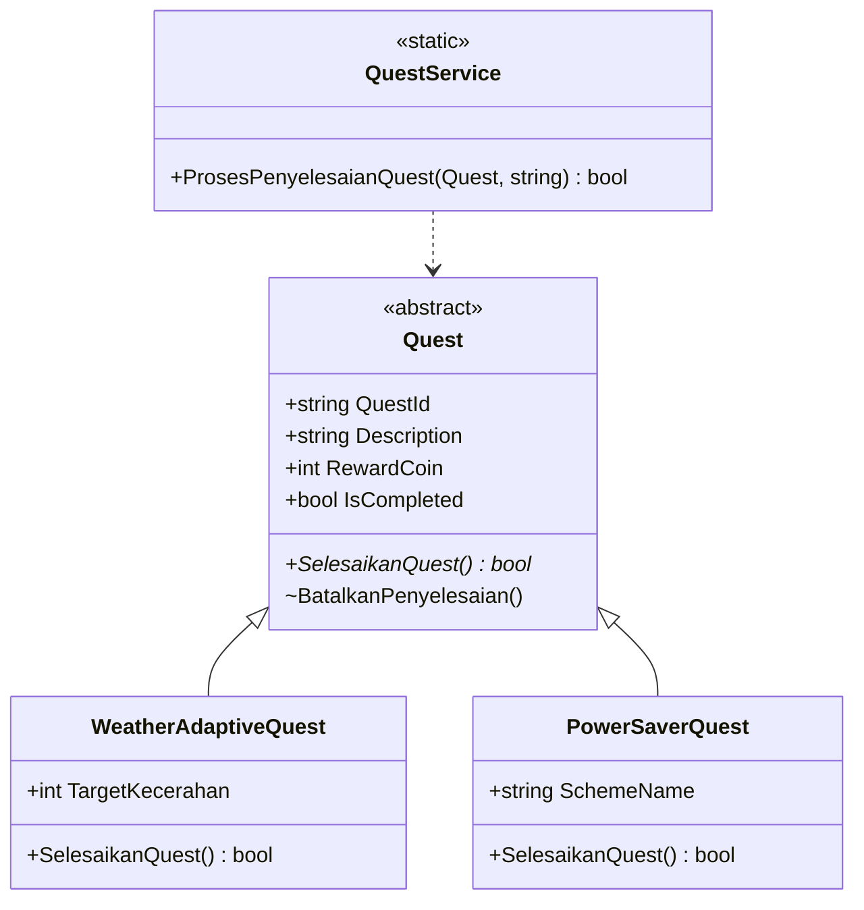

# 6. Prototipe WinForms (arsip referensi)

> **Kondisi target:** prototipe ini dipertahankan sebagai **arsip referensi tugas PBO** dan **bukan bagian rilis**. Fungsinya sudah diserap ke produk: hierarki quest abstrak → `DailyQuest` + turunan ([dokumen 3](03-domain-model.md)), `DatabaseHelper` (PostgreSQL) → `IAppRepository` / `PostgresRepository` ([dokumen 4](04-database.md)), form statis → View WPF ([dokumen 5](05-wpf-app.md)). Isi di bawah mendokumentasikan prototipe apa adanya.

Lokasi: `src/EcoKoin.WinForms.Prototype/` · Project: `ecokoin7.csproj` (assembly/namespace `ecokoin7`, `net10.0-windows`, `UseWindowsForms`, paket `Npgsql` 10.0.3) · Solusi: `src/WinFormsAppEcoKoin.slnx`.

Tujuan: demo konsep **Pemrograman Berorientasi Objek** (inheritance, polymorphism, encapsulation, abstraction) dengan alur Dashboard → Analisis → Misi & Reward yang menyimpan koin ke database PostgreSQL. Ini prototipe tugas kuliah (PBO), bukan basis produk final.

## Form

| File | Peran |
|---|---|
| `Program.cs` | `Application.Run(new Form1())` |
| `Form1` (Dashboard) | Ringkasan: saldo EcoKoin, cuaca, kelembapan, status daya, ringkasan CO₂/Rupiah/energi, status EcoPet, tombol *Terapkan* rekomendasi cuaca, tombol Daily Quest `+20`, navigasi ke Analisis dan Misi & Reward |
| `Form2` (Analisis) | Statistik mingguan (Energi 15 kWh, CO₂ 2.3 kg, Hemat Rp12.500), progress bar misi, dua insight teks, tombol Kembali |
| `Form3` (Misi & Reward) | Total EcoKoin, progress bar misi, dua misi (rekomendasi cuaca & Power Saver), tombol Kembali |

Form1 saat `Load` memanggil `EcoKoinData.MuatDataDariDatabase()`, lalu menyegarkan tampilan. Form2/Form3 dibuka sebagai dialog modal (`ShowDialog`) sambil menyembunyikan Form1.

## Hierarki quest (`QuestPBO.cs`)



| Konsep PBO | Di mana |
|---|---|
| **Abstraction** | `Quest` abstrak dengan `abstract bool SelesaikanQuest()` |
| **Inheritance** | `WeatherAdaptiveQuest`, `PowerSaverQuest` mewarisi `Quest` |
| **Polymorphism** | `QuestService.ProsesPenyelesaianQuest(Quest, ...)` memanggil `SelesaikanQuest()` sesuai tipe runtime |
| **Encapsulation** | `QuestId`/`Description` `private set`; `RewardCoin`/`IsCompleted` `protected set`; `BatalkanPenyelesaian()` `internal` |

Instance yang dipakai (di `EcoKoinData`):

| Objek | ID | Deskripsi | Reward | Parameter |
|---|---|---|---|---|
| `MisiKecerahan` (`WeatherAdaptiveQuest`) | `q_cuaca` | Kurangi kecerahan layar saat cuaca mendung | 15 | `TargetKecerahan = 50` |
| `MisiPowerSaver` (`PowerSaverQuest`) | `q_saver` | Aktifkan skema Power Saver | 20 | `SchemeName = "Power Saver"` |

Kedua `SelesaikanQuest()` hanya **simulasi**: menandai `IsCompleted = true`; tidak mengubah kecerahan layar atau skema daya Windows.

## Alur penyelesaian quest

```
Klik tombol (Form1/Form3)
  └─ EcoKoinData.SelesaikanMisi*()
       └─ QuestService.ProsesPenyelesaianQuest(quest, CurrentUser)
            ├─ quest null / sudah selesai → false
            ├─ quest.SelesaikanQuest()               (polimorfik)
            ├─ DatabaseHelper.TambahKoin(user, reward)   UPDATE USERS SET total_ecokoin = total_ecokoin + @koin
            │     └─ gagal → quest.BatalkanPenyelesaian(), return false (bisa dicoba lagi)
            └─ EcoKoinData.TotalKoin += reward → true
  └─ MessageBox "berhasil (simulasi)" + refresh tampilan
```

Progress misi = `MisiSelesai * 100 / 2` (0, 50, 100 persen). Status pet di Form1: 2 misi selesai → "Bahagia!", 1 → "Semangat!", 0 → state dari DB (default "Normal").

## `EcoKoinData` (state statis)

Penyimpan state global: `CurrentUser = "adnan"`, `TotalKoin = 120`, `PetState = "Segar"`, dua objek quest, properti turunan (`MisiSelesai`, `ProgressMisi`, `Misi*Selesai`). Quest **tidak dipersist**: status selesai hanya hidup selama proses berjalan; yang tersimpan ke DB hanya penambahan koin.

## `DatabaseHelper` (PostgreSQL)

| Pengaturan | Nilai |
|---|---|
| Host / Port | `localhost` / `5432` |
| Database | `ecokoin_db` |
| Username | `postgres` |
| Password | env var `ECOKOIN_DB_PASSWORD` (default string kosong) |

| Method | SQL | Perilaku gagal |
|---|---|---|
| `LoadUserData(username, out totalKoin, out petState)` | `SELECT u.total_ecokoin, COALESCE(p.current_state,'Normal') FROM USERS u LEFT JOIN ECO_PETS p ON u.user_id = p.user_id WHERE u.username = @user LIMIT 1` | exception ditelan; return `false`; nilai default 120 / "Normal" dipakai |
| `TambahKoin(username, tambahan)` | `UPDATE USERS SET total_ecokoin = total_ecokoin + @koin WHERE username = @user` | exception ditelan; return `false` |

Query diparameterisasi (aman dari SQL injection). Kredensial tidak disimpan di kode.

## Data hardcoded (simulasi)

Tidak diambil dari sumber nyata: cuaca (25°C Mendung), kelembapan (65%), status daya (75% On Battery), CO₂ 1.2 kg, tagihan Rp12.500, energi 2.5 kWh (Form1); energi 15 kWh, CO₂ 2.3 kg, hemat Rp12.500 (Form2) — perhatikan angka antar-form tidak konsisten; teks insight.

## Perbedaan dengan rancangan produk

- Prototipe memakai Npgsql langsung di form (`DatabaseHelper`); produk memakai `PostgresRepository` di balik `IAppRepository` (async) dengan skema v2 dan connection string dari `ECOKOIN_DB_CONNECTION`.
- `Quest` (prototipe, punya reward & state selesai) vs `DailyQuest` (`EcoKoin.Core/Models`, punya target & progress).
- State pet berupa string; belum memakai enum `PetState`.
- Tidak ada layer service untuk daya/cuaca; semua data tampilan statis.
