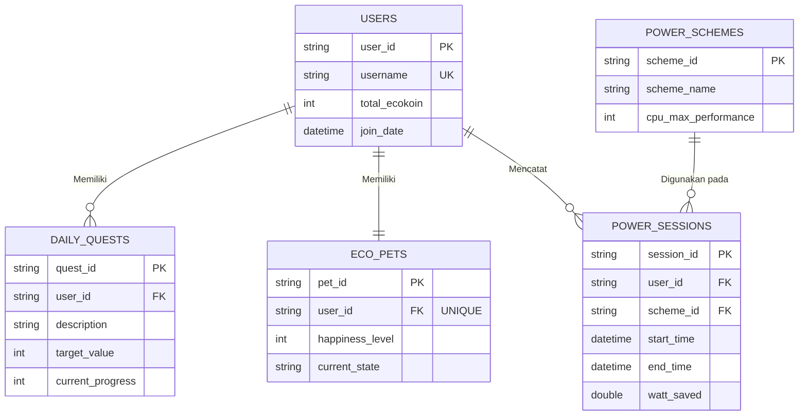

# EcoKoin — Entity Relationship Diagram

Sumber: `docs/erd-hw.pdf` (Modul 4 — Perancangan Basis Data).

## Relasi antar entitas

1. **USERS 1 — * DAILY_QUESTS.** Satu pengguna dapat memiliki banyak quest harian, tapi tiap quest cuma dimiliki satu pengguna. Direalisasikan lewat `user_id` di `DAILY_QUESTS` sebagai foreign key ke `USERS.user_id`.

2. **USERS 1 — 1 ECO_PETS.** Satu pengguna punya satu EcoPet, satu EcoPet cuma milik satu pengguna. Direalisasikan lewat `user_id` di `ECO_PETS` sebagai foreign key ke `USERS.user_id`, dan `user_id` di `ECO_PETS` dibuat **UNIQUE** biar relasi one-to-one terjamin di level database.

3. **USERS 1 — * POWER_SESSIONS.** Satu pengguna bisa mencatat banyak sesi penghematan daya, tiap sesi cuma tercatat untuk satu pengguna. Direalisasikan lewat `user_id` di `POWER_SESSIONS` sebagai foreign key ke `USERS.user_id`.

4. **POWER_SCHEMES 1 — * POWER_SESSIONS.** Satu skema daya bisa dipakai di banyak sesi, tiap sesi pakai satu skema daya. Direalisasikan lewat `scheme_id` di `POWER_SESSIONS` sebagai foreign key ke `POWER_SCHEMES.scheme_id`.

## Entitas yang sengaja tidak masuk database

`WeatherData` dan `CarbonFinancialReport` tetap ada sebagai class C# (`Models/WeatherData.cs`, `Models/CarbonFinancialReport.cs`) tapi **bukan tabel**:

- `WeatherData` — data cuaca diambil langsung dari API lewat `WeatherService`, dipakai sementara buat rekomendasi kecerahan layar, tidak perlu disimpan permanen.
- `CarbonFinancialReport` — total watt dihemat, pengurangan CO2, dan penghematan rupiah semua bisa dihitung ulang dari `watt_saved` di `POWER_SESSIONS`, jadi tidak perlu tabel sendiri.

Kedua class itu fungsinya class pendukung (ambil/olah data), bukan penyimpan data utama.
